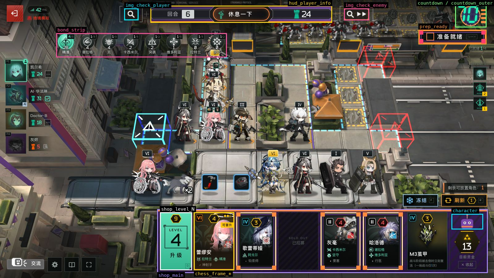
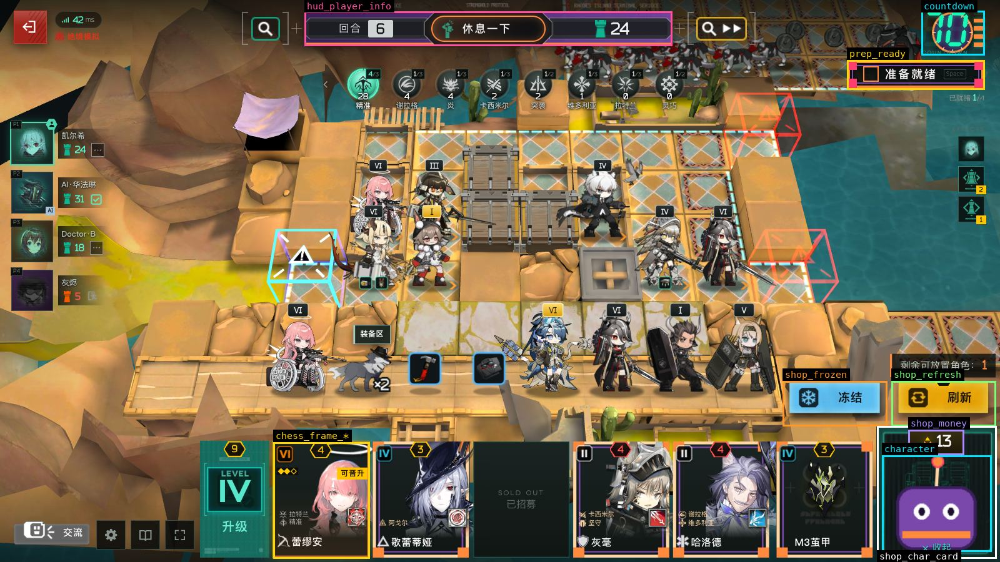
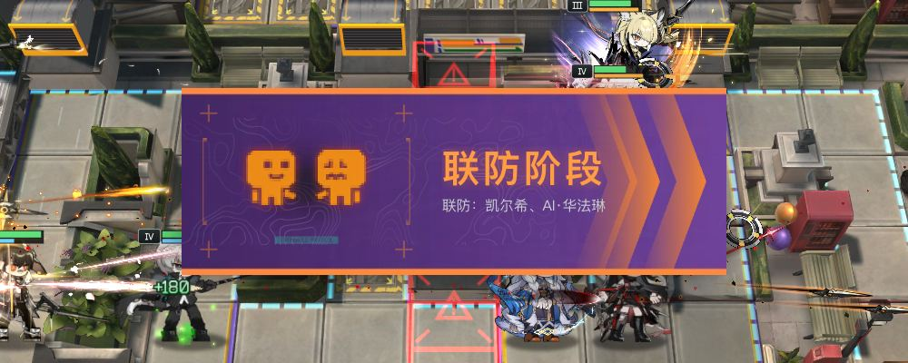
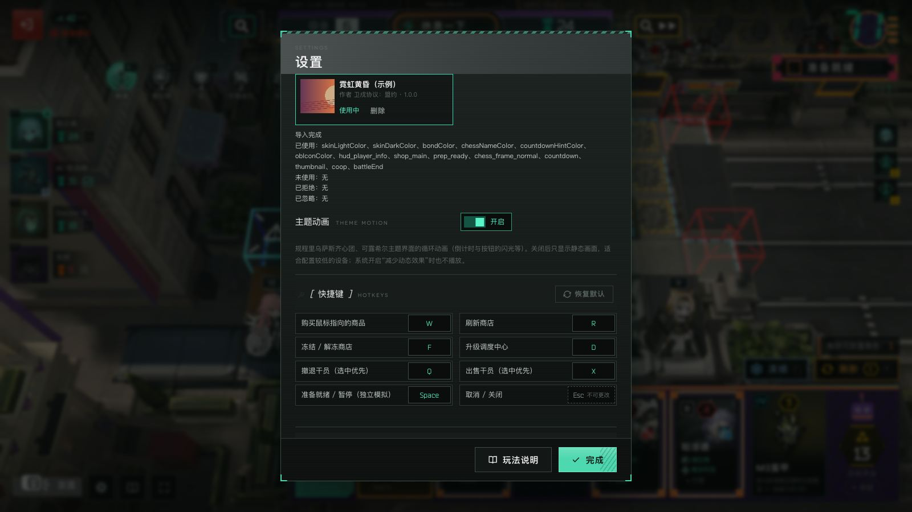

# 界面主题制作指南

这份指南讲怎么从零做一个界面主题包，适用于 0.4.0 及以后的版本。字段和图位的完整规格（英文）在 [THEMES.md](THEMES.md)，两份对不上时以 THEMES.md 为准。

仓库里有一个能直接导入的示例包 [examples/ui-theme-demo](examples/ui-theme-demo/theme.json)（「霓虹黄昏（示例）」）：几种颜色、五个界面图位、两个九宫格、一个动态横幅和一个 Spine 小角色，全部是原创图形。边看边对照它最快。

## 1. 主题包能换什么

界面主题是玩家导入到自己浏览器里的界面皮肤：不上传，服务器不参与，其他玩家看不到，也不改变对局。

| 能换 | 不能换 |
|---|---|
| 12 个官方颜色键，以及界面的颜色、动画时长变量 | 干员、敌人、地图和特效的形象 |
| 四十多个界面图位：顶栏、倒计时、准备按钮、商店、卡框、阶数标记、弹窗底板等 | 对局规则和数值 |
| 联防、结算、最终攻势等阶段横幅 | 界面的排版：元素的位置和大小不变，图片画在原来的元素上 |
| 13 种时机的主题语音 | 官方主题「乌萨斯齐心团」「可露希尔」那种按官方预制体画的顶栏、电视倒计时、规程卡面和横幅动画 |
| 资金框里的角色：一张图（可以是动图），或者一个会动的 Spine 小人 | |

想换干员外观、给全房间换东西，用的是服主安装的插件，见 [PLUGINS.md](PLUGINS.md)。

## 2. 五分钟做出第一个主题包

1. 新建一个文件夹，例如 `我的主题`，在里面新建文本文件 `theme.json`（UTF-8 编码），写入：

   ```json
   {
     "spTheme": 1,
     "id": "my-first-theme",
     "name": "我的第一个主题",
     "author": "你的名字",
     "version": "1.0.0",
     "colors": { "skinLightColor": "#FF8A3D", "countdownHintColor": "#FF3D6E" }
   }
   ```

2. 打开游戏，在标题画面、大厅、房间或对局里点「设置」，找到「界面主题」，点「导入文件夹」，选这个文件夹。也可以先把文件夹压成 zip，再点「导入主题包」。
3. 导入后会自动选用，下面出现导入报告。进一局看看：资金数字、准备按钮的边框和倒计时都变成了橙色。
4. 改了文件就再导入一次。同一个 `id` 会替换旧的，不会多出一个主题。

想一次看到所有可填的位置，可以在游戏文件夹里运行 `node tools/theme-template.mjs 我的主题`，它会写出一份列出全部图位、横幅和语音时机的空白 `theme.json`。仓库里也有一份：[examples/ui-theme/theme.json](examples/ui-theme/theme.json)。空着的项目会被忽略。

## 3. theme.json 的字段

| 字段 | 必填 | 说明 |
|---|---|---|
| `spTheme` | 是 | 固定写数字 `1` |
| `id` | 是 | 主题的标识：小写字母、数字、`-`、`_`，最长 40 个字符，以字母或数字开头。`terminal` 留给内置主题。`ac_n_initial`、`ac_n_iron`、`ac_s_closur` 是官方主题的 id，会按官方主题包处理，不要用 |
| `name` | 是 | 卡片上显示的名字，最长 40 个字符 |
| `author` / `version` / `description` | 否 | 作者（≤ 40）、版本（≤ 32，随意写）、一句话说明（≤ 300）。写错格式会导致整个包被拒收 |
| `thumbnail` | 否 | 卡片缩略图，建议 192×108。`preview` 也能写，但目前界面上不显示 |
| `colors` | 否 | 官方颜色键，见第 4 节 |
| `tokens` | 否 | 界面的颜色、时长、缓动变量，见第 4 节 |
| `images` | 否 | 界面图位，见第 5 节 |
| `banners` | 否 | 阶段横幅，见第 6 节 |
| `voice` | 否 | 主题语音，见第 7 节 |
| `character` | 否 | 资金框里的角色，见第 8 节 |

文件路径都相对于 `theme.json` 所在的文件夹，用 `/` 分隔，例如 `ui/shop.png`。不能写网址、绝对路径或 `..`。图片支持 png、jpg、webp（动态 WebP 也行）和 APNG，音频支持 ogg、mp3。

一项写错时只丢掉那一项，其余照常导入；导入报告会写明原因（第 10 节）。

## 4. 颜色和界面变量

`colors` 用官方的颜色键名，值写 `#RGB`、`#RRGGBB`，或者带透明度的 `#RRGGBBAA`。只在对局画面里生效，没写的键保持原样。

| 键 | 用在哪里 |
|---|---|
| `skinLightColor` | 主题亮色：商店资金的强调色、查看按钮边框、准备胶囊、倒计时数字（警告时除外）、商店等级卡、免费刷新、准备按钮边框、薄荷色的阶段牌 |
| `skinDarkColor` | 主题暗色：商店栏的上边框、商店等级卡的边框 |
| `bondColor` | 规程卡上盟约名和盟约图标的颜色（主题设置了卡框图位时） |
| `bondIconColor` | 顶栏盟约圆标里图案的颜色 |
| `chessNameColor` | 规程卡上干员名的颜色（主题设置了卡框图位时） |
| `saleColor1` / `saleColor2` | 出售标签和详情面板里的价格 / 出售牌上的字 |
| `destroyColor1` / `destroyColor2` | 销毁标签 / 销毁牌上的字 |
| `countdownHintColor` | 倒计时快结束、进入警告时的颜色 |
| `obIconColor` | 观战图标 |
| `garrisonIconColor1` | 驻守特性的标签 |

`garrisonIconColor2`、`garrisonIconColor3` 会收下，但本作没有对应的位置。

`tokens` 改的是整个界面（大厅也算）的设计变量，只影响你自己的屏幕。可以用的名字有：背景 `--bg-0`～`--bg-4`、`--bg-glass`，线条 `--line`、`--line-2`、`--line-3`，主色 `--mint-400`～`--mint-900` 等，`--gold`、`--amber`、`--orange`、`--red`、`--ice` 系列，文字 `--text-hi`、`--text-md`、`--text-lo`、`--text-dim`，难度和阶数颜色 `--diff-*`、`--tier-1`～`--tier-6`，以及动画的 `--t-fast`、`--t-med`、`--t-slow`（0–2000ms）和 `--ease-out`、`--ease-in-out`。完整名单和写法见 [PLUGIN-GUIDE.md](PLUGIN-GUIDE.md) 的「主题与公告」。例如 `"tokens": { "--t-fast": "0s" }` 会关掉界面里的快速过渡动画。

## 5. 界面图位

`images` 的键是图位名，值是图片路径，或者 `{ "src": 路径, "slice": [上, 右, 下, 左] }`（九宫格，见 5.1）。



*图 1：盟约版本休整期，示例主题导入后。框出的是主要图位，框上的名字就是 `images` 里的键。*



*图 2：规程版本的商店另有一套图位（刷新、冻结、资金徽章、角色卡），卡框在规程卡上是整张卡面。*

### 5.1 四种画法

| 画法 | 效果 | 适合 |
|---|---|---|
| 拉伸 | 整张图拉满元素，叠在元素原来的底色上 | 底板、渐变条 |
| 九宫格 | 写了 `slice` 时：四个角不缩放，四条边拉伸，中间留给元素自己的底色（不填充） | 有边框、会变宽变窄的按钮和框 |
| 包含 | 按原比例缩放到元素里，居中 | 表盘、图标 |
| 图标 | 替换原来的小标记 | 阶数标记、等级标记 |

`slice` 是四个整数，单位是 CSS 像素，顺序是上、右、下、左，表示四条边各留多宽不拉伸。示例包的准备按钮 `ui/ready.png` 四角是 16×16 的粉色方块，所以写 `"slice": [16, 16, 16, 16]`：按钮变宽时，四个方块保持原样，只有边框拉长。量切片时，就量图里边框（含圆角、花纹）的厚度。

卡框（`chess_frame_*`）没写 `slice` 时按 8 像素切。图位在页面上按 CSS 像素绘制，屏幕清晰度高时会被放大，所以建议按下表参考尺寸的 2 倍作图，切片数值仍按 1 倍写。

### 5.2 图位一览

参考尺寸是在 1600×900 窗口下量的元素大小（宽×高，CSS 像素）；窗口大小或「界面大小」设置不同时会有变化，按这个比例作图即可。标「—」的位置大小随内容变化，或者只在特定阶段出现。盟约商店里，角色缩小放在资金数字上方，区域约 102×50；规程商店的角色卡约 191×212，角色区域约 175×154。

**顶栏**

| 图位 | 位置 | 画法 | 参考尺寸 |
|---|---|---|---|
| `hud_player_info` | 顶栏中间的长条（回合、阶段、生命） | 拉伸；写 `slice` 时按九宫格 | 588×55 |
| `img_check_player` | 顶栏左边的「查看自己」按钮 | 拉伸，按图片比例 | 46×38 |
| `img_check_enemy` | 顶栏右边的「查看敌人」按钮 | 拉伸，按图片比例 | 81×38 |
| `countdown` | 右上角倒计时数字后面 | 包含 | 101×71 |
| `countdown_outer` | 倒计时外框 | 包含 | 101×71 |
| `prep_ready` | 「准备就绪」按钮 | 拉伸；写 `slice` 时按九宫格 | 220×47 |

**商店**

| 图位 | 位置 | 画法 | 参考尺寸 |
|---|---|---|---|
| `shop_main` | 商店卡牌那一排的底板 | 拉伸 | 1070×206 |
| `shop_level_1` … `shop_level_6` | 盟约商店左边的调度中心等级卡（按当前等级） | 包含，画在等级卡中间；图里要自己画「LEVEL」和数字，原来的字会隐藏 | —（等级卡约 103×187） |
| `img_shop_sell_chess_normal` / `img_shop_sell_chess_hover` | 拖动干员时出现的出售按钮底板 / 鼠标悬停时 | 拉伸 | — |
| `char_spine_outer` | 资金框里角色身后的底板（主题有 Spine 角色时） | 包含；写 `slice` 时按九宫格 | — |
| `shop_refresh` / `shop_refresh_lock` | 规程商店的「刷新」按钮 / 不能刷新时 | 拉伸 | 167×72 |
| `shop_frozen` / `shop_frozen_on` / `shop_frozen_lock` | 规程商店的「冻结」按钮：未冻结 / 已冻结（显示「解冻」）/ 不能用时 | 拉伸 | 167×72 |
| `shop_money` | 规程商店的资金徽章 | 拉伸 | — |
| `shop_char_card` | 规程商店右端的角色卡 | 拉伸 | 191×212 |
| `shop_cost_free` | 规程卡上和刷新按钮上的「免费」牌 | 拉伸 | — |
| `shop_card_empty` | 两个商店里没有卡的栏位：买走以后的，和调度中心升级刚开出、还没补卡的（不含奖励卡那一排的「已选择」） | 拉伸；写 `slice` 时按九宫格，中间也画（这个位置没有底色可留） | 154×186（规程）/ 130×187（盟约） |
| `shop_shadow` | 商店打开时屏幕底部的阴影，整个屏幕宽，两个商店都有 | 拉伸，贴着屏幕底边 | 1600×284 |

**卡牌**

| 图位 | 位置 | 画法 | 参考尺寸 |
|---|---|---|---|
| `chess_frame_normal` | 1–4 阶卡框 | 九宫格；规程卡上是整张卡面（中间也显示） | 130×187 |
| `chess_frame_level_five` / `chess_frame_level_six` | 5 阶 / 6 阶卡框 | 同上 | 同上 |
| `chess_level_icon_1` … `chess_level_icon_6` | 卡上的阶数标记 | 图标，替换原来的罗马数字 | — |

规程卡上，卡框图就是整张卡面，图里透明的地方会露出我们的深色底。想要浅色或别的底色（像可露希尔的卡那样），直接画进卡框图里；规程的角色卡（`shop_char_card`）也一样，透明处露出深绿底。

空栏位：主题包没给 `shop_card_empty` 时，两个商店都显示官方「卫戍协议终端」的「[ NO INFO ]」空卡（完整包带官方素材；精简包没有，显示「SOLD OUT」）；盟约卡比规程卡窄，官方空卡在盟约卡上保持原比例、和卡一样宽、上下居中。`shop_card_empty` 的图在两个商店都铺满整张卡，会被拉成不同比例；不想变形就画成有边框的图并写 `slice`。

商店阴影：商店打开时，屏幕底部有一层官方的黑色渐变阴影（「卫戍协议终端」那一层，1600×900 下高约 284 像素），两个商店都有，在所有按钮下面，不挡点击。`shop_shadow` 换掉这层阴影：图片横向铺满屏幕宽，高度固定，从上到下的渐变最好画成上端透明。

**弹窗与阶段画面**

| 图位 | 位置 | 画法 |
|---|---|---|
| `game_start` | 开局「协议启动」画面 | 铺满 |
| `round_start` | 回合开始弹窗的底板 | 拉伸 |
| `round_result` | 回合结算框 | 写 `slice` 时按九宫格，否则拉伸。同时设了结算横幅 `battleEnd` 时，请给它切片 |
| `help_battle` | 「本局信息」（敌方情报）抽屉 | 写 `slice` 时整张作为边框画在抽屉上，否则包含 |
| `effect_choose_self_select` | 机变自选窗口 | 拉伸 |
| `countdown_effectchoose` | 机变时的倒计时 | 包含 |
| `boss_damage` | 领袖关的血条 | 拉伸；写 `slice` 时按九宫格 |
| `bond_strip` | 盟约条 | 拉伸 |
| `detail_panel` | 干员详情面板 | 拉伸 |

下面这些键会收下，但本作没有对应的位置，报告里列为「未使用」：`img_check_buff_back`、`img_check_buff_normal`、`img_check_buff_count`、`win_streak`、`effect_choose_group_tip`、`img_shop_sell_equip_normal`、`img_shop_sell_equip_hover`。

## 6. 阶段横幅

`banners` 替换阶段横幅的底图，上面的字仍是游戏自己的。值可以是路径（拉伸），也可以是 `{ "src", "slice" }`（九宫格）。

| 键 | 用在哪里 |
|---|---|
| `gameStart` | 开局「协议启动」画面；没有开局图时也用作阶段横幅 |
| `coop` | 联防牌 |
| `battleEnd` | 回合结算框 |
| `perfect` | 全员无伤时的结算框；没写时用 `battleEnd` |
| `finalAssault` | 最终攻势牌 |
| `bossDamage` | 领袖关的血条胶囊 |

`rest`、`effectChoose`、`perfectStreak` 会收下，但现在没有对应的横幅。

## 7. 主题语音

`voice` 的键是官方的语音时机，值是一个音频路径，或者最多 8 个路径的列表（每次随机选一个）。同一时间只播一句，优先数字小的；音量跟「干员语音」滑块走，静音或滑块为 0 时听不到（角色的对应动作照常播放）。

| 时机 | 概率 | 冷却（秒） | 什么时候 |
|---|---|---|---|
| `AUTOCHESS_GAME_START` | 1 | 0 | 协议启动；页面打开时已经开局的话，第一回合的回合开始 |
| `AUTOCHESS_REST_BOSS` | 1 | 0 | 领袖关开战前的休整期 |
| `AUTOCHESS_ALLIANCE_LEVEL` | 1 | 0 | 某个盟约的层数提高 |
| `AUTOCHESS_SHOP_UPGRADE` | 1 | 10 | 调度中心升级 |
| `AUTOCHESS_REST_NO_HP_LOSS` | 0.8 | 200 | 打完一场没掉生命后的第一个休整期 |
| `AUTOCHESS_REST_HIDDEN_BOSS` | 1 | 0 | 隐秘回合的休整期 |
| `AUTOCHESS_COUNTDOWN` | 0.5 | 0 | 倒计时进入警告，每次截止一次 |
| `AUTOCHESS_REST_HP_LOSS` | 0.8 | 200 | 打完一场掉了生命后的第一个休整期 |
| `AUTOCHESS_MERGE_TRIPLE` | 0.4 | 5 | 三合一拿到奖励 |
| `AUTOCHESS_SAME_OPERATOR` | 0.3 | 10 | 买到已经有的干员 |
| `AUTOCHESS_BUY_OPERATOR_HIGH` | 0.3 | 10 | 买到新的 4–6 阶干员 |
| `AUTOCHESS_BUY_OPERATOR_LOW` | 0.2 | 10 | 买到新的 1–3 阶干员 |
| `AUTOCHESS_FREEZE` | 0.5 | 15 | 冻结商店 |

语音文件名会被用来对应 Spine 角色的动作（8.2 节），建议起 `cn_001.mp3` 这样不重复的名字。

## 8. 做动态主题

主题里能动的有三处：动图、资金框里的 Spine 角色、界面过渡动画的时长（`tokens` 的 `--t-*`）。乌萨斯齐心团和可露希尔那种顶栏、电视倒计时、卡面和横幅窗口的动画，是按官方游戏的界面预制体逐层画的，没有给作者用的格式，第三方主题做不出来。

### 8.1 动图

任何图位和横幅都可以用动态 WebP 或 APNG，在游戏里会循环播放。示例包的联防横幅 `banners/coop.webp` 就是 11 帧的动态 WebP：一道光扫过底板。

把一组 PNG 帧（`frame_001.png`、`frame_002.png`……）做成动图：

- **APNG**：ffmpeg 自带 APNG 编码器，输出的文件仍以 `.png` 结尾：

  ```bash
  ffmpeg -framerate 15 -i frame_%03d.png -plays 0 -f apng banner.png
  ```

- **动态 WebP**（通常比 APNG 小）：GIMP 导出 WebP 时勾选「作为动画」；或者用 Python 的 Pillow：

  ```python
  from PIL import Image
  frames = [Image.open(f'frame_{i:03d}.png') for i in range(1, 13)]
  frames[0].save('banner.webp', save_all=True, append_images=frames[1:], duration=70, loop=0)
  ```

  `ffmpeg -encoders` 里有 `libwebp_anim` 时，也可以用 `ffmpeg -framerate 15 -i frame_%03d.png -c:v libwebp_anim -loop 0 banner.webp`。



*图 3：示例包的联防横幅（动态 WebP，截图是其中一帧）。横幅上的字和图标是游戏自己的，主题只换底图。*

动图同样受单张 8 MB、每边 4096 像素的限制。帧数多、尺寸大的动图会占内存，横幅这类大图建议控制在几十帧以内。

### 8.2 Spine 角色

资金框里可以放一个 Spine 小人：平时循环播放待机动作，播放主题语音时切到对应的动作，播完回到待机。盟约和规程的资金框都会显示。

**需要的文件**：用 [Spine](https://esotericsoftware.com/) 编辑器导出的骨骼文件（JSON 或二进制 `.skel`）、`.atlas` 和贴图 PNG。支持 Spine 3.7、3.8、4.0、4.1，推荐 3.8（官方主题也是 3.8）；4.2 不支持。

**导出设置**：

- 数据选 JSON 或二进制都可以。
- 纹理打包：atlas 和 PNG 一起导出。用 3.8 及更早版本时，取消勾选「预乘 Alpha（Premultiply alpha）」，否则边缘会发黑；4.0 及以后的 atlas 会记录这个选项，勾不勾都行。
- 贴图每张不超过 4096×4096、8 MB；骨骼和 atlas 各不超过 8 MB。

**写进 theme.json**：

```json
"character": {
  "spine": {
    "skel": "character/neon.json",
    "atlas": "character/neon.atlas",
    "textures": ["character/neon.png"]
  },
  "anims": {
    "idle": "Idle",
    "voice": { "cn_001": "Happy", "cn_002": "Talk" }
  }
}
```

- `textures` 列出 atlas 用到的每一张贴图，文件名要和 atlas 里写的一样。只有一张贴图时，名字不一样也能配上。
- `anims.idle` 是待机动作的名字，不写时找 `Idle`，再找 `Default`，都没有就用第一个动作。
- `anims.voice` 把语音文件名（不含扩展名，例如 `voice/cn_001.mp3` 写 `cn_001`）对应到动作名。这句语音播放时，角色播一次这个动作，然后回到待机。

**尺寸**：角色按骨骼在第一帧的范围缩放到资金框里，居中显示。动作尽量不要超出待机时的范围太多，骨骼周围也不要留大片空白，否则角色会显得很小。盟约商店的资金栏比较矮，角色会缩到约 102×50（1600×900 下）；规程商店的角色卡大得多（约 175×154）。两种商店都看一眼，确保缩小后也认得出来。

示例包的 `character/neon.*` 是一个手写的 Spine 3.8 小角色（`Idle` 上下浮动，`Happy` 跳一下，`Talk` 眨眼），可以在 Spine 里用「导入数据（Import Data）」打开它，当作起点修改。

只想要一张会动的图，不必用 Spine：`"character": { "image": "character/me.webp" }` 也接受动态 WebP 和 APNG。

## 9. 上限

| 项目 | 上限 |
|---|---|
| `theme.json` | 64 KB |
| 文件数 | 400 个 |
| 单张图片 | 8 MB，解码后每边不超过 4096 像素 |
| 单个音频 | 4 MB |
| Spine 骨骼、atlas | 各 8 MB |
| 整个包 | 64 MB |
| 一个浏览器里的自制主题 | 8 个（同一个 `id` 替换旧的，不算新的一个） |
| 每个语音时机 | 8 句 |

## 10. 自测

导入后，主题页下面会出现导入报告：



*图 4：导入示例包后的「界面主题」：卡片上是缩略图、名字、作者和版本，下面是导入报告。*

- **已使用**：生效了的颜色、变量、图位、横幅和语音时机。
- **未使用**：收下了，但本作没有对应位置的键（例如 `win_streak`）。
- **已拒绝**：有问题的项目和原因，例如文件太大、找不到、格式不对、切片数值无效、颜色写错。只丢掉这一项。
- **已忽略**：包里有、但 `theme.json` 没有用到的文件，例如说明文字。

然后进对局检查。图位分布在不同阶段，建议开一局单人模拟走一遍：休整期（顶栏、商店、卡牌、准备按钮）、战斗、联防横幅、回合结算、领袖关血条。盟约版本和规程版本的商店图位不同（图 1、图 2），两种都看一眼。

常见问题：

- **图变形**：给有边框的图写 `slice`；或者按图位的参考比例作图。
- **颜色没变**：检查键名大小写，以及颜色是不是写在 `colors` 里。
- **图被拒绝**：看报告里的原因，多半是尺寸、格式或路径不对。
- **想退回原样**：在主题页选「卫戍协议终端」；不要了就点主题卡上的「删除」，只从这台设备删除。

主题存在浏览器里，按网址分开：同一个地址的服务器更新了也还在，换了地址或端口要重新导入。

## 11. 打包和分享

- 把整个文件夹压成 zip：`theme.json` 放在 zip 的根目录，或者 zip 里唯一的一个文件夹中。
- 图片和声音请只用你有权分发的。本作的官方素材（包括官方主题的贴图和语音）归原权利人所有，不要打进自己的主题包。
- 更新时保持 `id` 不变、改 `version`，玩家重新导入就会替换旧版本。
- 玩家在「设置 → 界面主题」点「导入主题包」导入，不需要服主做任何事。

## 12. 官方主题和可露希尔主题包

完整包自带两套官方主题：「卫戍协议终端（官方贴图）」和「乌萨斯齐心团」，卡片上有「官方」标记。“全能的”可露希尔不随包提供，维护者另外提供主题包 `Stronghold-Protocol-v<版本>-theme-ac_s_closur.zip`，同样在「导入主题包」导入。官方主题的顶栏和卡面按官方预制体绘制，第三方主题包只能使用本指南里的图位。官方主题的空栏位也取自各自的卡牌预制体：卫戍协议终端和可露希尔是「NO INFO」空卡，乌萨斯齐心团是鹰徽海报；商店底部的阴影和装饰也按各自的商店预制体画（乌萨斯齐心团左下角的斜带，可露希尔左下角的底栏和右下角的暗角）。这些在盟约版本也一样。

## 附：示例包的文件

| 文件 | 用途 |
|---|---|
| `theme.json` | 主题清单 |
| `thumb.png` | 卡片缩略图 |
| `ui/band.png` | `hud_player_info`，拉伸 |
| `ui/shop.png` | `shop_main`，拉伸 |
| `ui/ready.png` | `prep_ready`，九宫格 16 |
| `ui/frame.png` | `chess_frame_normal`，九宫格 14，中间透明 |
| `ui/countdown.png` | `countdown`，包含 |
| `banners/coop.webp` | 联防横幅，动态 WebP |
| `banners/result.png` | 结算框横幅，九宫格 24 |
| `character/neon.json`、`neon.atlas`、`neon.png` | Spine 3.8 小角色 |

在「界面主题」点「导入文件夹」，选 `docs/examples/ui-theme-demo` 就能看到效果。
